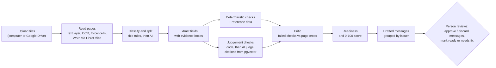
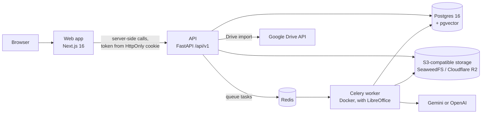

# ShipReady

ShipReady checks the documents of an Indian export shipment before they reach customs. You upload every document of one shipment, and ShipReady reads them, cross-checks them against each other and against official Indian reference data, points to the exact place on the page behind every finding, suggests whether the shipment is ready, and drafts the messages that ask the right party to fix what is wrong. A person makes every final decision.

It is a solo showcase project for exporters, customs brokers (CHAs) and freight forwarders. All test documents are synthetic.

## The problem

An export shipment needs a set of documents that must agree with each other: commercial invoice, packing list, purchase order, shipping bill, bill of lading or air waybill, certificate of origin and the GST LUT acknowledgement. They are produced by different people (sales, warehouse, forwarder, customs broker), in different formats (ERP PDFs, Excel sheets, Word files, scans, phone photos), at different times. A description, HS code, weight, package count or exchange rate that differs between them is one of the most common reasons a shipping bill is queried or rejected. Today these cross-checks are done by eye.

ShipReady does that cross-checking automatically and shows its evidence, so a person can confirm each finding in seconds instead of re-reading every page.

## How it works

1. **Upload.** A signed-in user creates a shipment and uploads its files (PDF, Word, Excel, JPEG, PNG, TIFF), from the computer or Google Drive. The type is taken from the file's bytes, not its name. Limits: 30 files per request, 25 MB each. A file whose bytes are already in the shipment is stored once and reported as a duplicate.
2. **Read pages.** A background worker reads every page and keeps each word's position: the PDF text layer when there is one, OCR (RapidOCR) for scans and photos (upside-down pages are turned and read again), cells for Excel, and LibreOffice to turn Word files into PDFs first.
3. **Classify.** Each page is matched to a document type by its title; an untitled page continues the previous document; the AI decides only what the rules cannot (`CLASSIFY_WITH_AI`). A file holding several documents is split into parts.
4. **Extract with evidence.** One AI request per shipment reads every field of every document. Each value is stored with the quote it came from and that quote's box on the page (or its cell in a sheet).
5. **Check.** 29 deterministic checks run as plain code over the fields and the reference tables (quantities, values, exchange rates, weights, containers, HS codes, export policy by date, identifiers, ports, dates). Six judgement checks (descriptions, parties, description against HS code, LUT statement, required documents) are decided by code where possible and by one AI judge request otherwise; failures of GST-01 and DOC-01 cite the regulation passage they rely on. Every check gives pass, fail, or not verified (a value missing, or reference data that cannot decide).
6. **Critic.** Each failed blocker or major check is shown to a vision model with crops of the page images where its values are printed; a confident misreading is set aside as not verified.
7. **Readiness.** The shipment gets a suggested readiness (ready, needs fix, needs review) and a 0-100 score weighted by severity.
8. **Draft messages.** Failed checks are grouped by the party who issued the wrong document (forwarder, customs broker, buyer, certifier, or the exporter's own team), and one message is drafted for each.
9. **Human review.** The run waits for a person, who edits, approves or discards each message and marks the shipment ready (a reason is required while a blocker fails) or needing fixes. ShipReady never sends a message or files anything itself.



Each processing of a shipment is a **run** that moves through the stages reading, extracting, checking and drafting, records an event at each step, and streams them live as Server-Sent Events. A shipment has at most one active run. Uploading more files or asking for a re-check starts the work again.

## Architecture



| Component | Role |
|---|---|
| Web app (`web/`) | Next.js 16 App Router: sign-in, the shipment queue and the upload page with live progress. |
| API (`backend/src/shipready/api`) | FastAPI under `/api/v1`: sign-in, shipments, uploads, Drive import, results, runs and review. |
| Worker (`backend/src/shipready/worker.py`) | Celery with Redis. Reads pages, classifies, extracts, checks, runs the critic and drafts messages. Runs in Docker (`backend/Dockerfile`) because Word files need LibreOffice. |
| Postgres 16 with pgvector | Check catalogue, reference data, shipments, documents, pages, fields, check results, runs, messages, approvals and the regulatory-text index. |
| Redis | Task queue (Render Key Value when deployed). |
| Object storage | Uploaded files and page images. SeaweedFS locally; Cloudflare R2 when deployed. |
| AI provider | Gemini or OpenAI, chosen in `.env`. |

**Sign-in and tokens (Decision D-36, D-38).** Users are stored in the database with scrypt-hashed passwords. `POST /api/v1/auth/login` returns a signed HS256 token (12 hours, or 30 days with "keep me signed in"). The web app signs in through a server action and keeps the token in an HttpOnly, SameSite=Lax cookie. Every API call is made from the web app's server, so no script in the browser ever holds the token and the API needs no CORS. The API checks the token on every request.

**Google Drive import (Decision D-37).** The browser uses Google's Picker with the `drive.file` scope and sends the picked file IDs and the Picker's short-lived access token to `POST /api/v1/shipments/{id}/documents:import-drive`. The API fetches the files during that request (Google Docs exported as PDF, Sheets as Excel) and stores them exactly like an upload. The token is used for that request only. It is never stored, queued or logged. The web app's upload screen has the "Choose from Google Drive" button.

## Tech stack

| Area | Choice |
|---|---|
| Backend | Python 3.12, uv workspace, FastAPI, uvicorn, Pydantic, SQLAlchemy 2, Alembic, psycopg 3, PyJWT, Celery |
| Document reading | pypdfium2 (rendering, text layer with boxes), RapidOCR on onnxruntime, Pillow, openpyxl, headless LibreOffice for Word files |
| AI | Gemini (`google-genai`) or OpenAI (Responses API with Structured Outputs), behind one provider-neutral layer (`shipready.ai`) |
| Data | PostgreSQL 16 with pgvector, Redis, S3 API through boto3 (SeaweedFS locally, Cloudflare R2 when deployed) |
| Web | Next.js 16 (App Router, Cache Components), React 19, TypeScript, Tailwind CSS 4, `@googleworkspace/drive-picker-react` |
| Infrastructure | Docker Compose locally (Postgres, SeaweedFS, Redis, worker); Vercel for the web app and Render for the API, worker, Postgres and Key Value when deployed |
| Synthetic data (dev only) | ShipGen: Faker, ReportLab, python-docx, Pillow, openpyxl |
| Testing and CI | pytest, hypothesis, moto (S3), FastAPI test client; ruff; mypy (strict); ESLint and TypeScript for the web app; GitHub Actions with a Postgres service |

## API overview

All routes are under `/api/v1`. Every route except `health` and `auth/login` needs a bearer token. Another organisation's shipment, document, run or message answers 404. Interactive docs are at `/docs` when the API is running.

| Method | Path | Purpose |
|---|---|---|
| GET | `/health` | Liveness check (no token) |
| POST | `/auth/login` | Email and password for a signed token |
| POST | `/shipments` | Create a shipment (reference unique per organisation) |
| GET | `/shipments` | List shipments, newest first, with queue summaries (`q`, `limit`, `offset`) |
| GET | `/shipments/{id}` | A shipment with its documents, status, readiness and score |
| GET | `/shipments/{id}/fields` | Every extracted field with its quote, page and box |
| GET | `/shipments/{id}/checks` | Every check's outcome, evidence, citations and the critic's verdict |
| POST | `/shipments/{id}/documents` | Upload files (multipart `files`); duplicates reported, not stored twice |
| POST | `/shipments/{id}/documents:import-drive` | Import picked Google Drive files with the Picker's short-lived token |
| GET | `/documents/{id}` | One document |
| GET | `/shipments/{id}/runs` | The shipment's runs |
| POST | `/shipments/{id}/runs` | Check again (409 while a run is active or files are unread) |
| GET | `/runs/{id}` | One run |
| GET | `/runs/{id}/events` | Live run events as Server-Sent Events (`Last-Event-ID` resumes) |
| GET | `/shipments/{id}/messages` | Drafted messages |
| PATCH | `/messages/{id}` | Edit a draft's subject or body |
| POST | `/messages/{id}/approve` | Approve a draft (ShipReady does not send it) |
| POST | `/messages/{id}/discard` | Discard a draft |
| POST | `/shipments/{id}/mark-ready` | Mark ready (a `reason` is required while a blocker fails); ends the run |
| POST | `/shipments/{id}/mark-needs-fix` | Mark as needing fixes; ends the run |
| GET | `/shipments/{id}/approvals` | Every human decision recorded for the shipment |

## AI providers

ShipReady runs on either Gemini or OpenAI (Decision D-35):

- Only `GEMINI_API_KEY` set: Gemini. Only `OPENAI_API_KEY` set: OpenAI.
- Both set: `AI_PROVIDER` (`gemini` or `openai`) must say which. Without it, or with an `AI_PROVIDER` whose key is missing, the API and worker refuse to start.
- Each step (classify, extract, judge, critic, drafter, embeddings) can use its own model through `GEMINI_*_MODEL` or `OPENAI_*_MODEL` settings; defaults are in `backend/.env.example`.
- Rate limits, overloads and dropped connections from either provider become the same wait, and the Celery task retries.
- The regulatory index records the embedding model that built it. After switching provider, rebuild it with `python -m shipready.knowledge.index`.

Free-tier providers may keep what is sent to them, so a free-tier key is used with synthetic documents only.

## Repository layout

```
.
├── PLAN.md                 # target design and plan
├── docker-compose.yml      # local Postgres 16 + pgvector, SeaweedFS, Redis and the worker
├── docker/                 # local storage keys and the test-database init script
├── .github/workflows/      # CI: lint, format, types, tests, evaluation gate
├── backend/                # Python uv workspace
│   ├── src/shipready/      # the product: API, worker, reading, AI steps, checks, reference data, db
│   ├── migrations/         # Alembic migrations
│   ├── tests/              # unit, property, database and API tests
│   ├── shipgen/            # dev-only synthetic shipment and document generator (never deployed)
│   ├── evals/              # dev-only evaluation harness and committed baseline
│   ├── Dockerfile          # the worker image, with LibreOffice
│   └── .env.example        # backend settings (names and local values only)
├── web/                    # Next.js web app
│   ├── src/app/            # sign-in, sign-out and the signed-in pages (shipment queue)
│   ├── src/lib/            # session cookies, server-only API calls, formats, types
│   └── .env.example        # web settings (API address, Google Picker IDs)
└── data/                   # downloads, datasets and evaluation reports (git-ignored)
```

## Getting started locally

### Prerequisites

- Docker
- [uv](https://docs.astral.sh/uv/) (installs Python 3.12 if needed)
- Node.js 20 or later (web app)
- LibreOffice, only to read Word files outside Docker (for example when running the evaluation harness); the worker's Docker image already has it

### Backend

From the repository root:

```bash
docker compose up -d                                          # Postgres 16, storage and Redis
cd backend
cp .env.example .env                                          # then set SHIPREADY_JWT_SECRET and an AI key
uv sync                                                       # create .venv and install dependencies
uv run --env-file .env alembic upgrade head                   # create the tables
uv run --env-file .env python -m shipready.db.seed            # catalogue, UQC codes, countries
uv run python -m shipready.reference.fetch all                # official downloads (about 10 minutes)
uv run --env-file .env python -m shipready.db.load all        # validate and load (about 20 seconds)
uv run --env-file .env python -m shipready.storage            # create the local bucket (once)
uv run python -m shipready.knowledge.fetch                    # regulatory texts into ../data/knowledge
uv run --env-file .env python -m shipready.knowledge.index    # index them in pgvector (again after switching AI provider)
```

`backend/.env.example` explains how to generate a value for `SHIPREADY_JWT_SECRET`.

Create a person who can sign in (it asks for the password, at least 12 characters):

```bash
uv run --env-file .env python -m shipready.users add --email you@example.com --name "Your Name"
```

Run the API and the worker:

```bash
uv run --env-file .env uvicorn shipready.api.app:app --reload   # http://localhost:8000, docs at /docs
docker compose up -d --build worker                              # the worker in Docker, with LibreOffice
```

The worker can also run outside Docker (`--pool=solo` on Windows; Word files then need LibreOffice and `SOFFICE_PATH`):

```bash
uv run --env-file .env celery -A shipready.worker worker --pool=solo --loglevel=info
uv run --env-file .env python -m shipready.worker requeue        # queue files left 'uploaded' (e.g. Redis was down)
```

### Web app

With the API running on port 8000:

```bash
cd web
cp .env.example .env.local      # then fill in the values
npm install
npm run dev                     # http://localhost:3000; sign in with the user created above
```

### Environment variables

Names only; see the two `.env.example` files for descriptions and local defaults.

| File | Variables |
|---|---|
| `backend/.env` | `DATABASE_URL`, `TEST_DATABASE_URL`, `S3_ENDPOINT_URL`, `S3_BUCKET`, `S3_ACCESS_KEY_ID`, `S3_SECRET_ACCESS_KEY`, `S3_REGION`, `SHIPREADY_JWT_SECRET`, `REDIS_URL`, `CLASSIFY_WITH_AI`, `SOFFICE_PATH`, `AI_PROVIDER`, `GEMINI_API_KEY`, `GEMINI_*_MODEL`, `OPENAI_API_KEY`, `OPENAI_*_MODEL`; for the harness only, `EVALS_PAGE_CACHE`, `EVALS_ANSWER_CACHE` |
| `web/.env.local` | `SHIPREADY_API_URL`, `NEXT_PUBLIC_GOOGLE_CLIENT_ID`, `NEXT_PUBLIC_GOOGLE_API_KEY`, `NEXT_PUBLIC_GOOGLE_APP_ID` |

## Testing and quality

Backend, from `backend/`:

```bash
uv run --env-file .env pytest          # all tests (no network; database tests need TEST_DATABASE_URL)
uv run ruff check .                    # lint
uv run ruff format --check .           # formatting
uv run mypy                            # strict type check
```

Web app, from `web/`:

```bash
npm run lint && npx tsc --noEmit && npm run build
```

CI (GitHub Actions) runs lint, format, type check and the test suite against a real Postgres on every push and pull request, then rebuilds the labelled dataset and fails if any evaluation score drops below the committed baseline.

### Synthetic data: ShipGen

ShipGen is a dev-only package that generates golden export shipments deterministically from a seed, injects labelled errors (each mapped to the rules that must catch it) and look-alike non-errors that no rule may report, proves every label with an oracle, and splits cases 60/20/20 into dev, validation and test. Each case is written as the files an exporter receives: PDFs in three house styles, Word files, scans, phone photos and Excel packing lists. Every page carries a specimen note.

```bash
uv run python -m shipgen --count 5 --seed 42 --out ../data/shipgen                # golden shipments as JSON
uv run python -m shipgen.dataset --count 200 --seed 42 --out ../data/dataset       # labelled dataset with files (minutes)
```

### Evaluation harness

`python -m evals` scores a pipeline on a dataset split against the targets in `PLAN.md` Section 16 and writes a JSON and Markdown report. Pipelines: `empty`, `rules`, `rules+ai`, `ai` (classification), `extract`, `checks`, `checks-on-labels` and `checks+critic`. AI answers and page reads are cached on disk, so scoring again spends no quota.

```bash
uv run python -m evals --pipeline rules --split validation
uv run --env-file .env python -m evals --pipeline extract --split validation
uv run --env-file .env python -m evals --pipeline checks-on-labels --split validation
uv run python -m evals --pipeline empty --split validation --gate evals/baseline.json
```

Measured results on the synthetic validation split (small samples because of the free-tier quota):

| Measure | Result |
|---|---|
| Classification accuracy | 100% (317 of 317 files), title rules alone and with AI fallback |
| Field accuracy (7 shipments) | 99.6% on digital documents, 98.0% on scanned or photographed ones; line-item F1 98.7%; evidence found for 100% of correct fields |
| All checks on labelled fields | Recall 100%, precision 100%, no false alarm on a clean shipment |
| End to end (18 shipments) | Recall 100%; precision 77.1% without the critic, 88.1% with it |
| Readiness on labelled fields | Every clean shipment ready, every faulty one needs fix |

## Data and privacy

- **Synthetic data only.** Every document used in development and evaluation is a ShipGen specimen. No real customer documents are in the repository or have been processed.
- **Free-tier AI keys get synthetic documents only**, because free tiers may let the provider keep what is sent. OpenAI requests are sent with `store=False`.
- **Tokens are never stored.** The Google Picker token is used during one request and never stored, queued or logged. The API token lives only in an HttpOnly cookie on the web app's server side. Passwords are stored as salted scrypt hashes.
- **Uploads are checked at the boundary.** File type comes from the bytes, sizes are limited, and storage keys are sanitised so a file name cannot leave its folder.
- **A person decides.** ShipReady suggests readiness and drafts messages; it never sends a message or files with customs.
- **Secrets stay in `.env` files**, which are git-ignored; only `.env.example` files with names and local values are committed.

## Documentation

- `PLAN.md` (in this repository): the target design, the check catalogue and the architecture.
- `Flow.md` and `Decision.md`: local working documents kept beside the code and not published in this repository. `Flow.md` describes how the system works today; `Decision.md` records each design decision (D-1 to D-38) with its alternatives and consequences.
